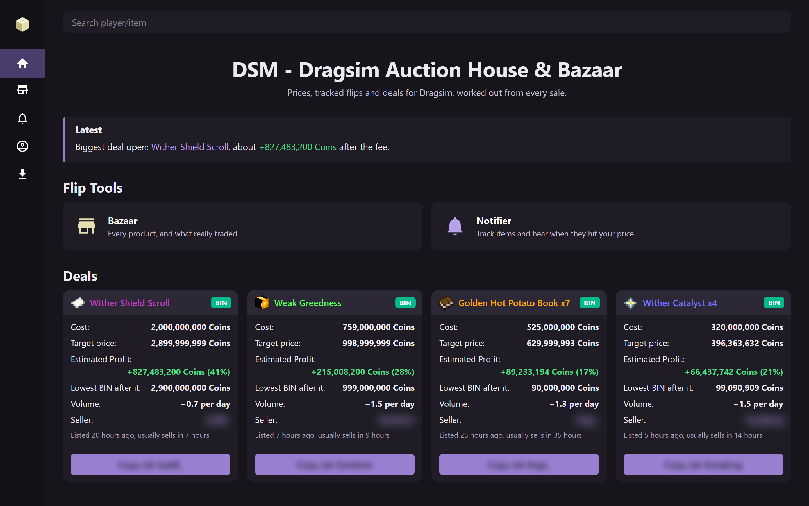
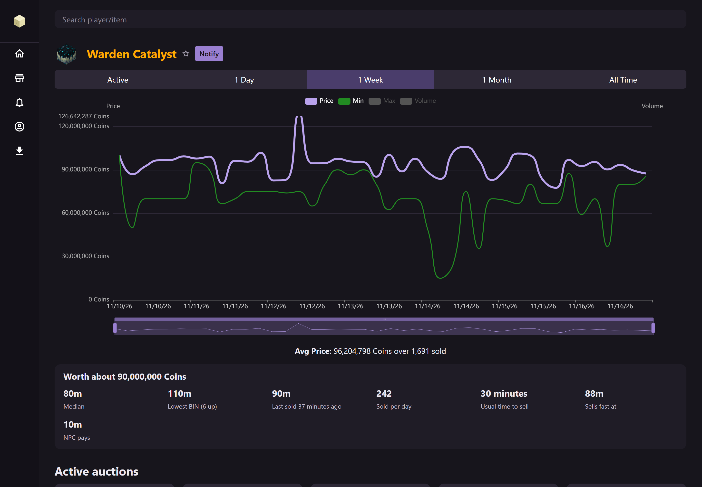
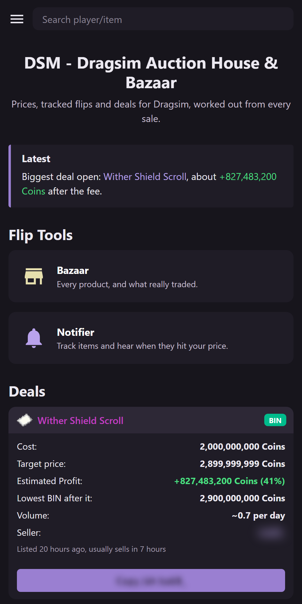
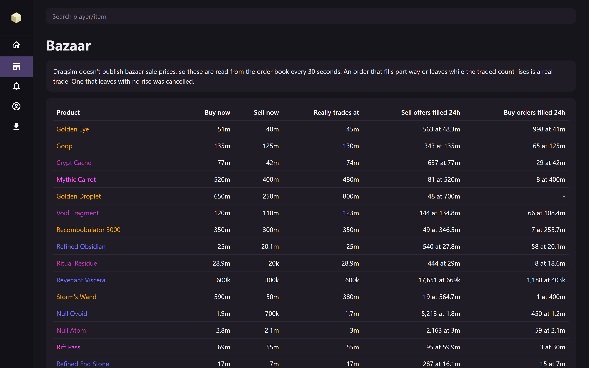

<h1 align="center">DSM · Dragsim Market</h1>

  Prices, deals, tracked flips and price alerts for the Dragsim Minecraft server, 
  worked out from every auction house sale and bazaar trade.

  <a href="https://dsmnet.xyz/"><b>dsmnet.xyz</b></a> ·
  <a href="../../releases/latest">Download the mod</a> ·
  <a href="#check-what-you-run">Check what you run</a>

  
  
  
  

  

## What it does

- **Deals.** Auctions listed under what the item really sells for, with the profit after the
  auction house fee, how fast it sells, and the next cheapest listing behind it.
- **A price for every item.** Built from recent sales of copies like yours: upgrades, stars,
  skins and stack size count, and troll listings, gifts and stacks sold as one don't.
- **Bazaar, read properly.** Dragsim never publishes what bazaar products sold for, so DSM reads
  it from the order book every 30 seconds.
- **Notifier.** Follow any item and get told in game or on Discord when one lists at your price.
- **Tracked flips.** Link your account and every buy, sell and trade you make is paired into
  flips, with where each coin went.
- **Prices on hover.** The mod adds lowest BIN, median and craft cost under items in game.

<table>
  <tr>
    <td width="74%"></td>
    <td width="26%"></td>
  </tr>
  <tr>
    <td colspan="2"></td>
  </tr>
</table>

## The mod

Requires Minecraft 26.1.2, Fabric Loader 0.19.2 or newer, Fabric API and Java 25.

1. Download `dsm-<version>.jar` from [Releases](../../releases/latest) into your `mods` folder.
2. Join Dragsim and run `/dsm link`.
3. Enter the code it shows on [dsmnet.xyz](https://dsmnet.xyz/). Your Notifier, flips and alerts
   are now yours.

Trade uploads are off until you turn them on with `/market trades on`. More in
[`mod/README.md`](mod/README.md).

### Check what you run

Every release is built by GitHub from the commit it names, and publishes the jar's SHA-256.

- **Against the hash:** `sha256sum -c dsm-<version>.jar.sha256`, or on Windows
  `Get-FileHash dsm-<version>.jar` and compare it with the release.
- **Against the code:** build the named commit yourself with JDK 25
  (`cd mod && ./gradlew build`). The build is reproducible on any OS, so
  `mod/build/libs/dsm-<version>.jar` comes out byte for byte the same as the release.

## Repository

| Folder | What it is |
| --- | --- |
| [`server/`](server) | The market service. Python standard library only. How to run it is in [`server/README.md`](server/README.md). |
| [`server/site/`](server/site) | The website: plain HTML, CSS and JavaScript, no build step. |
| [`mod/`](mod) | The Fabric mod. |

Tests: `cd server && python -m unittest discover -s tests`, and `cd mod && ./gradlew build` runs
the mod's checks.

This repository holds the code only. The live market's price history, trades, linked accounts
and keys are not here and never will be.

## Licence

AGPL-3.0, see [`LICENSE`](LICENSE). Parts of the pricing engine are adapted from Coflnet's
open-source auction tools, which are AGPL-3.0 too; see [`NOTICE`](NOTICE).
